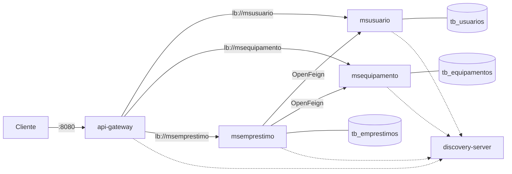

# Sistema de Empréstimo de Equipamentos

Atividade prática de Microsserviços: primeira etapa, comunicação síncrona.

## Arquitetura



| Aplicação | Responsabilidade | Banco próprio |
|---|---|---|
| discovery-server | Registro e descoberta das instâncias via Eureka | Não se aplica |
| api-gateway | Ponto de entrada e roteamento de requisições | Não se aplica |
| msusuario | Cadastrar e consultar usuários | `tb_usuarios` (schema `msusuario`) |
| msequipamento | Cadastrar, consultar e reservar/liberar equipamentos | `tb_equipamentos` (schema `msequipamento`) |
| msemprestimo | Coordenar solicitações, registrar empréstimos e devoluções | `tb_emprestimos` (schema `msemprestimo`) |

O msemprestimo chama o msusuario e o msequipamento via OpenFeign, pelo nome registrado no Eureka e com Spring Cloud LoadBalancer. A api-gateway roteia com `lb://` e não tem regra de negócio. Cada serviço tem o seu próprio banco, sem chave estrangeira entre eles; o empréstimo guarda só `usuarioId` e `equipamentoId`.

Stack: Java 21, Spring Boot 4.1.2, Spring Cloud 2025.1.4, Spring Data JPA, MySQL, Flyway, Eureka, OpenFeign, Spring Cloud LoadBalancer e Spring Cloud Gateway Server WebFlux.

## Portas adotadas

| Aplicação | Porta |
|---|---|
| discovery-server | 8761 |
| api-gateway | 8080 |
| msusuario, msequipamento, msemprestimo | aleatória (`server.port: 0`), localizada via Eureka |

Todas as requisições do cliente passam pela api-gateway, na porta 8080.

## Execução

Pré-requisitos: Java 21, Maven e MySQL em `localhost:3306` com usuário `root` e senha `root`. Os schemas são criados na inicialização e as tabelas pelas migrations Flyway.

Suba cada aplicação em um terminal, nesta ordem:

```bash
cd discovery-server && mvn spring-boot:run
cd msusuario && mvn spring-boot:run
cd msequipamento && mvn spring-boot:run
cd msemprestimo && mvn spring-boot:run
cd api-gateway && mvn spring-boot:run
```

Em http://localhost:8761 devem aparecer API-GATEWAY, MSUSUARIO, MSEQUIPAMENTO e MSEMPRESTIMO.

## Exemplos de requisições

```bash
curl -X POST http://localhost:8080/api/v1/usuarios -H 'Content-Type: application/json' \
  -d '{"nome":"Maria","email":"maria@escola.edu","matricula":"MAT001"}'

curl http://localhost:8080/api/v1/usuarios/<usuarioId>

curl -X POST http://localhost:8080/api/v1/equipamentos -H 'Content-Type: application/json' \
  -d '{"nome":"Notebook Dell","tipo":"NOTEBOOK","patrimonio":"PAT001"}'

curl http://localhost:8080/api/v1/equipamentos/<equipamentoId>

curl http://localhost:8080/api/v1/equipamentos/disponiveis

curl -X POST http://localhost:8080/api/v1/emprestimos -H 'Content-Type: application/json' \
  -d '{"usuarioId":"<usuarioId>","equipamentoId":"<equipamentoId>"}'

curl http://localhost:8080/api/v1/emprestimos/<emprestimoId>

curl http://localhost:8080/api/v1/emprestimos/usuarios/<usuarioId>

curl -X PATCH http://localhost:8080/api/v1/emprestimos/<emprestimoId>/devolucao -H 'Content-Type: application/json' \
  -d '{"condicao":"AVARIADO"}'
```

Resposta do `POST /api/v1/emprestimos`:

```http
HTTP/1.1 201 Created
{
  "id": "33333333-3333-3333-3333-333333333333",
  "usuarioId": "11111111-1111-1111-1111-111111111111",
  "equipamentoId": "22222222-2222-2222-2222-222222222222",
  "dataEmprestimo": "2026-11-14T14:00:00",
  "dataDevolucao": null,
  "status": "ATIVO"
}
```

A collection `postman/emprestimo-equipamentos.postman_collection.json` traz todos os endpoints e os cenários de teste. Importe no Postman e execute as pastas em ordem; as pastas 5 e 7 exigem parar o msequipamento antes (a 7 segue as instruções de cada request).

## Limites de consistência

Como cada serviço tem o próprio banco, não existe uma transação única entre a reserva do equipamento e o registro do empréstimo. A reserva é idempotente pelo `emprestimoId` e o msequipamento usa bloqueio no banco para impedir reservas concorrentes. Se a reserva ou o registro do empréstimo falha, o msemprestimo pede a liberação do equipamento. Se essa liberação também falhar (por exemplo, com o msequipamento fora do ar), o equipamento fica reservado sem empréstimo e precisa ser liberado manualmente.
